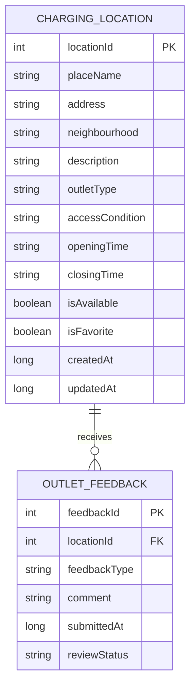
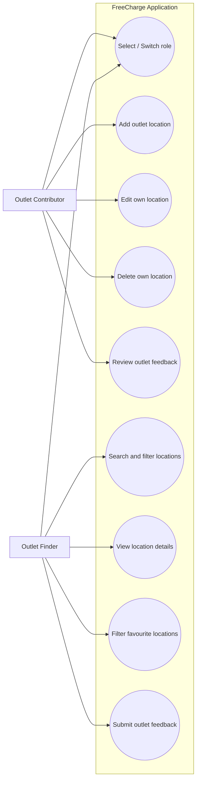
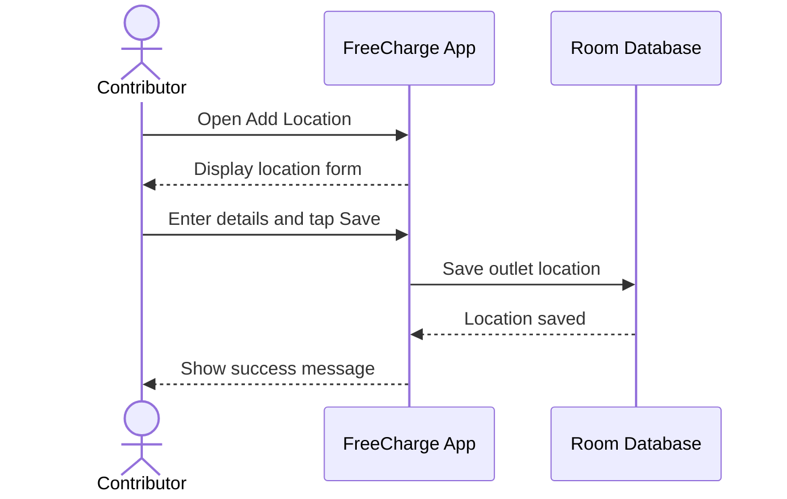
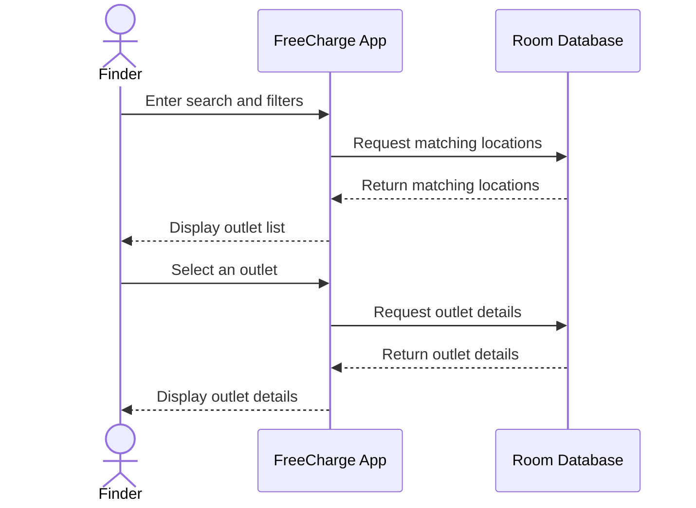

# FreeCharge: Free Electrical Outlet Finder

**Course:** CSIS 4175-002 – Mobile Application Development II  
**Term:** Fall 2026  
**Team members:** Akito Nakajima (Student ID: 300422052) and Alex Kim (Student ID: 300427965)  
**Document status:** First draft  

---

## 1. Project Title and Description

### Project title

**FreeCharge: Free Electrical Outlet Finder**

### Project description

FreeCharge is an Android application that helps people find publicly accessible electrical outlets for charging phones, laptops, tablets, and other small personal devices. It also allows trusted contributors to add and maintain information about places where electrical outlets are available.

The application will be developed in Android Studio using Java and XML layouts. Room will be used as the local database layer over SQLite. The main version will use an address-based list rather than requiring a live map or external location service. This keeps the project focused on the technical concepts covered in CSIS 4175: activities, fragments, navigation, Room entities and DAOs, CRUD operations, RecyclerView, listeners, validation, dialogs, and user feedback.

FreeCharge will support two distinct locally selected roles:

1. **Outlet Contributor:** adds, edits, manages, and removes charging locations.
2. **Outlet Finder:** searches and filters charging locations, marks favourites, and submits feedback about outlet availability.

The main workflow is:

> Contributor adds an outlet location → Finder searches for the location → Finder views its details → Finder saves or visits it → Finder confirms that it is working or reports a problem → Contributor reviews the feedback and updates the listing.

---

## 2. Problem Statement and Objectives

### 2.1 Problem statement

People frequently need to charge a phone or laptop while studying, travelling, working remotely, or waiting in a public place. Although electrical outlets may be available in libraries, cafés, community centres, shopping areas, and educational institutions, information about them is usually incomplete or difficult to find. A person may arrive at a location and discover that the outlet is unavailable, restricted to customers, unsuitable for a laptop, or no longer working.

Existing map applications primarily identify businesses and buildings rather than individual charging amenities. FreeCharge addresses this problem by maintaining structured, community-provided information specifically about electrical outlets. Each listing will describe the location, supported device type, opening hours, access conditions, and current availability.

### 2.2 Project objectives

The objectives of FreeCharge are to:

- Help users quickly find places where they can charge a phone, laptop, or both.
- Allow contributors to create and maintain reliable outlet listings.
- Clearly communicate access conditions, such as completely free access or purchase required.
- Allow finders to report whether information is correct or an outlet is unavailable.
- Demonstrate two distinct user roles with different screens and permissions.
- Implement persistent local data storage using Room and SQLite.
- Demonstrate complete Create, Read, Update, and Delete operations.
- Provide structured navigation using activities and fragments.
- Apply input validation, error handling, confirmation dialogs, and user feedback.
- Demonstrate meaningful Android interaction through confirmation dialogs and feedback messages.

---

## 3. Target Users and Intended Purpose

### 3.1 Role separation

The prototype will support exactly two role modes: one Finder and one Contributor. It will not support multiple user accounts. The active role can be chosen from the Role Selection screen without profiles, passwords, or authentication. A Finder cannot create, edit, or delete outlet listings. A Contributor can manage locally stored listings and review feedback connected to them. Only the features of the selected role will be displayed.

### 3.2 Outlet Finders

Outlet Finders are people who need temporary access to electricity while away from home. Examples include:

- College and university students
- Remote workers
- Travellers and commuters
- Library and community-centre visitors
- People whose phone battery is low during an emergency

Their purpose for using FreeCharge is to search for an appropriate charging location, check its conditions and hours, mark useful places as favourites, and provide availability feedback after visiting.

### 3.3 Outlet Contributors

Outlet Contributors are people who know about accessible outlets and are willing to maintain listings. Examples include:

- Café or business employees
- Library or community-centre staff
- Campus staff or student volunteers
- Community members familiar with public facilities

Their purpose for using FreeCharge is to add reliable charging locations, keep listing information accurate, review feedback, and update or remove outdated listings.

---

## 4. Proposed Features and Functionalities

### 4.1 Shared features

- Select either Finder or Contributor from the Role Selection screen.
- Open the dashboard and navigation for the selected role.
- Switch roles from the menu when needed.
- Validate required fields and display clear error messages.
- Display confirmation and error feedback using dialogs, Toasts, or Snackbars.

### 4.2 Outlet Contributor features

- View a contributor dashboard.
- Add a new charging location.
- Enter the place name, address, description, opening time, and closing time.
- Select an outlet type: `PHONE`, `LAPTOP`, or `BOTH`.
- Select an access condition: `FREE`, `PURCHASE_REQUIRED`, or `PERMISSION_REQUIRED`.
- Indicate whether the outlet is currently available.
- View all locations created by the contributor in a RecyclerView.
- Open the details of an existing listing.
- Edit a listing and save its updated information.
- Delete a listing after accepting a confirmation dialog.
- View feedback submitted for the contributor's listings.
- Mark feedback as resolved or dismissed after reviewing it.

### 4.3 Outlet Finder features

- View available charging locations in a RecyclerView.
- Search by place name, address, or neighbourhood.
- Filter by outlet type and access condition using Spinners.
- Open a location to view its complete information.
- Mark or unmark a location as a favourite.
- Filter the location list to show favourites only.
- Submit quick feedback that an outlet is working or not working.
- Submit a detailed problem report for a removed outlet or incorrect information.
- Add an optional comment to feedback.

### 4.4 Combined outlet feedback design

Quick confirmations and detailed problem reports will be stored in a single `OutletFeedback` table. The interface will provide simple **Working** and **Not Working** buttons as well as a **Report a Problem** form. The feedback type will be one of:

- `WORKING`
- `NOT_WORKING`
- `OUTLET_REMOVED`
- `WRONG_INFORMATION`

This design avoids creating two database tables with overlapping purposes while still demonstrating multiple input methods, Room relationships, status updates, and filtered queries.

---

## 5. Main Activities and Fragments

### 5.1 Activities

- **MainActivity:** Hosts the fragments and displays navigation for the selected role.

### 5.2 Shared fragments

- **RoleSelectionFragment:** Allows the user to continue as either Finder or Contributor.

### 5.3 Contributor fragments

- **ContributorDashboardFragment:** Provides shortcuts to contributor features.
- **AddEditLocationFragment:** Allows a contributor to add or edit an outlet location.
- **MyLocationsFragment:** Displays and manages outlet locations in a RecyclerView.
- **ContributorLocationDetailFragment:** Shows a location with Edit and Delete actions.
- **FeedbackManagementFragment:** Allows a contributor to review and resolve outlet feedback.

### 5.4 Finder fragments

- **FindLocationsFragment:** Displays searchable and filterable outlet locations in a RecyclerView.
- **LocationDetailFragment:** Shows outlet details and Finder actions.
- **SubmitFeedbackFragment:** Allows a Finder to submit outlet feedback or report a problem.

---

## 6. Preliminary Database Design

### 6.1 ChargingLocation entity

| Field | Type | Constraint or purpose |
|---|---|---|
| locationId | int | Primary key, auto-generated |
| placeName | String | Required |
| address | String | Required |
| neighbourhood | String | Optional search/filter value |
| description | String | Optional details |
| outletType | String | `PHONE`, `LAPTOP`, or `BOTH` |
| accessCondition | String | `FREE`, `PURCHASE_REQUIRED`, or `PERMISSION_REQUIRED` |
| openingTime | String | Required |
| closingTime | String | Required |
| isAvailable | boolean | Current listing status |
| isFavorite | boolean | Used to mark and filter favourite locations |
| createdAt | long | Creation timestamp |
| updatedAt | long | Last update timestamp |

### 6.2 OutletFeedback entity

| Field | Type | Constraint or purpose |
|---|---|---|
| feedbackId | int | Primary key, auto-generated |
| locationId | int | Foreign key to ChargingLocation |
| feedbackType | String | `WORKING`, `NOT_WORKING`, `OUTLET_REMOVED`, or `WRONG_INFORMATION` |
| comment | String | Optional for quick feedback; expected for detailed reports |
| submittedAt | long | Submission timestamp |
| reviewStatus | String | `PENDING`, `RESOLVED`, or `DISMISSED` |

### 6.3 Preliminary DAO operations

- `ChargingLocationDao`: insert, search/filter, update favourite status, update location details, and delete.
- `OutletFeedbackDao`: insert, list by location, list pending feedback for contributor, and update review status.

---

## 7. ER Diagram



---

## 8. Use Case Diagram



---

## 9. Sequence Diagrams

### 9.1 Sequence diagram 1: Contributor adds an outlet location



### 9.2 Sequence diagram 2: Finder searches for an outlet



---

## 10. Initial Wireframes and Screen Designs

### 10.1 Role selection

```text
┌──────────────────────────────┐
│          FreeCharge          │
│                              │
│       Continue as            │
│                              │
│  [      OUTLET FINDER      ] │
│  [   OUTLET CONTRIBUTOR    ] │
└──────────────────────────────┘
```

### 10.2 Finder location list

```text
┌──────────────────────────────┐
│ FreeCharge              ☰    │
│ [ Search name/address...  🔍]│
│                              │
│ Type: [Both ▼] Access:[Any ▼]│
│ [ ] Show favourites only     │
│                              │
│ ┌──────────────────────────┐ │
│ │ Douglas College Library  │ │
│ │ New Westminster          │ │
│ │ Phone + laptop • Free    │ │
│ │ Open until 9:00 PM    ☆  │ │
│ └──────────────────────────┘ │
│ ┌──────────────────────────┐ │
│ │ Corner Café              │ │
│ │ Columbia Street          │ │
│ │ Laptop • Purchase needed │ │
│ │ Open until 7:00 PM    ★  │ │
│ └──────────────────────────┘ │
│                              │
│       Find          Role      │
└──────────────────────────────┘
```

### 10.3 Location details and feedback

```text
┌──────────────────────────────┐
│ ‹ Location Details           │
│                              │
│ Douglas College Library     ☆│
│ 700 Royal Avenue             │
│                              │
│ Devices: Phone and laptop    │
│ Access: Free                 │
│ Hours: 8:00 AM – 9:00 PM    │
│ Status: Available            │
│                              │
│ Outlets near study tables on │
│ the second floor.            │
│                              │
│ Was the outlet working?      │
│ [ ✓ WORKING ] [ ✕ NOT WORKING]│
│                              │
│ [     REPORT A PROBLEM     ] │
└──────────────────────────────┘
```

### 10.4 Contributor location management

```text
┌──────────────────────────────┐
│ My Outlet Locations          │
│                              │
│ [ + ADD NEW LOCATION       ] │
│                              │
│ ┌──────────────────────────┐ │
│ │ Douglas College Library  │ │
│ │ Available                │ │
│ │ 2 pending reports        │ │
│ │ [EDIT] [DELETE] [REPORTS]│ │
│ └──────────────────────────┘ │
│                              │
│ ┌──────────────────────────┐ │
│ │ Community Centre Lobby   │ │
│ │ Temporarily unavailable  │ │
│ │ No pending reports       │ │
│ │ [EDIT] [DELETE] [REPORTS]│ │
│ └──────────────────────────┘ │
│                              │
│ Dashboard   Locations   Role  │
└──────────────────────────────┘
```

### 10.5 Add or edit location form

```text
┌──────────────────────────────┐
│ ‹ Add Charging Location      │
│                              │
│ Place name*                  │
│ [________________________]   │
│ Address*                     │
│ [________________________]   │
│ Neighbourhood                │
│ [________________________]   │
│ Outlet type*  [Both       ▼] │
│ Access*       [Free       ▼] │
│ Opens* [08:00] Closes*[21:00]│
│                              │
│ Description                  │
│ [________________________]   │
│ [________________________]   │
│                              │
│ Available now  [ ON ]        │
│ [          SAVE            ] │
└──────────────────────────────┘
```

---

## 11. Team Members and Assigned Responsibilities

### Akito Nakajima (Student ID: 300422052) — Contributor module lead

- Contributor dashboard and navigation
- Add/edit location form and validation
- Contributor location RecyclerView
- Update and delete operations
- Feedback-management screen
- Contributor-related Room queries and testing
- Contributor portion of diagrams, report, and presentation

### Alex Kim (Student ID: 300427965) — Finder module lead

- Finder dashboard and navigation
- Search, filter, and location RecyclerView
- Location details and favourite filtering
- Feedback submission
- Finder feedback and report functionality
- Finder-related Room queries and testing
- Finder portion of diagrams, report, and presentation

### Shared responsibilities

- Requirements and project planning
- Role-selection screen and role-based navigation
- Room database entities, relationships, and migrations
- Integration between the two modules
- Consistent XML styles and resources
- System testing and bug fixing
- Final report, demonstration, and presentation

The division assigns a visible application role to each student while still requiring both members to collaborate on database design and integration.
